# 滚动窗口 GJR-GARCH-skewt：方法与回测结论

本报告说明14家银行收益的单期 VaR 预测方法，并展示既有历史实验的完整复算结果。默认配置是1500条滚动窗口、每5条重新估计参数。报告日期：2026-11-13。

## 1. 研究问题与数据

目标是在每个收益出现以前，预测该银行下一条收益记录的1%与5%下尾分位数，分别对应99%与95%损失 VaR。每家银行独立估计一个模型；本项目没有估计银行间联合分布。

| 项目 | 设置 |
|---|---|
| 银行数量 | 14 |
| 输入记录 | 4575个共同日期 |
| 输入日期 | 2007-10-31至2026-10-08 |
| 初始化/开发段 | 前2000条 |
| 评价段 | 后2575条，2016-02-03至2026-10-08 |
| 收益单位 | 百分数对数收益 |
| 默认训练窗口 | 最近1500条已知收益 |
| 默认重估间隔 | 5条保留记录 |

收益由既有 BaoStock 归档中的涨跌幅构造：

$$r_t=100\log\left(1+\frac{\mathrm{pctChg}_t}{100}\right).$$

日期筛选沿用原实验。源宽表在当前起止日期之间有26个日期未进入计算输入，因此这里的“每期”指每条保留记录，不能一律解释为连续交易日。宁波银行的6条缺失涨跌幅在原处理时填0；平安银行有一处价格链与涨跌幅不一致，计算输入保留涨跌幅口径。详见 [数据说明](../data/README.md)。

## 2. 数学模型

对银行 $i$，省略银行下标后写为：

$$r_t=\mu+\epsilon_t,\qquad \epsilon_t=\sqrt{h_t}z_t,$$

$$h_t=\omega+\alpha\epsilon_{t-1}^2+\gamma\mathbf{1}\{\epsilon_{t-1}<0\}\epsilon_{t-1}^2+\beta h_{t-1}.$$

$z_t$ 使用均值为0、方差为1的 Hansen 偏 Student-t 分布，形状参数为自由度 $\eta$ 与偏度 $\lambda$。每家银行估计七个参数：

$$\theta=(\mu,\omega,\alpha,\gamma,\beta,\eta,\lambda).$$

负冲击由额外的 $\gamma$ 项影响方差。偏t分布允许厚尾与不对称。实际拟合采用 arch 包的 `mean='Constant', vol='GARCH', p=1, o=1, q=1, dist='skewt', rescale=False` 及其默认参数约束，不另行套用流式 Adam 版本的参数化约束。

重估时在最近1500条收益上最小化条件负对数似然：

$$\widehat\theta=\arg\min_{\theta}\sum_{s\in\mathcal W_t}\left[\tfrac12\log h_s(\theta)-\log f_{\eta,\lambda}\!\left(\frac{r_s-\mu}{\sqrt{h_s(\theta)}}\right)\right].$$

这里的 argmin 表示估计目标；实际获得的是数值优化器返回的解，不保证全局最优。窗口内部的初始化和回溯方差由 arch 实现。

## 3. 滚动估计与信息顺序

对评价日期 $t$，过程如下：

1. 只读取 $t$ 以前已经出现的收益。若达到重估日，取最近1500条收益重新拟合各银行参数，并获取下一期预测方差。
2. 使用预测前参数和方差计算收益分位数，保存预测。
3. 揭示当期实际收益，计算损失及违背指标。
4. 用刚揭示的收益递推下一期方差，将收益加入滚动窗口。

首次拟合冷启动。后续拟合以上次参数热启动、最多500次迭代；未收敛时冷启动重试、最多1500次。仍失败时保留该银行已有参数与当前预测方差，首次拟合失败直接报错。失败不会被隐藏或从评分期删除。

**两次重估之间参数固定，方差每期更新。**它不是每条收益都用 Adam 更新参数的版本，也不是每天使用全部历史重新拟合的版本。`--refit-every 1` 可改为每期重估滚动窗口，但本报告数值仅对应默认间隔5。

## 4. VaR 与评价指标

收益下尾预测为：

$$\widehat q_{\tau,t}=\widehat\mu_t+\sqrt{\widehat h_t}\,F^{-1}_{\widehat\eta_t,\widehat\lambda_t}(\tau),\qquad \tau\in\{0.01,0.05\}.$$

对损失 $L_t=-r_t$，定义：

$$\widehat{\mathrm{VaR}}_{1-\tau,t}=-\widehat q_{\tau,t}.$$

因此 `return_quantile` 通常为负，而 `var_loss_log_pct` 为其相反数；这里是百分数对数损失，不是货币金额，也不是简单百分比收益。

Pinball loss 使用：

$$\rho_\tau(u)=u\bigl(\tau-\mathbf{1}\{u<0\}\bigr),\qquad u=r_t-\widehat q_{\tau,t}.$$

损失越低越好。违背事件为 $r_t<\widehat q_{\tau,t}$，名义违背率分别为1%和5%。总体指标是相同评价日期内对银行与日期等权平均。银行间相关且收益存在时间依赖，这些观测不是独立重复样本。

## 5. 回测结果

| 指标 | 99% VaR | 95% VaR |
|---|---:|---:|
| 平均 pinball loss | 0.0421911647 | 0.1381022706 |
| 实际违背率 | 0.8655% | 4.9237% |
| 名义违背率 | 1% | 5% |
| 每银行名义违背次数 | 25.75 | 128.75 |

### 各银行 VaR 时序图

每张图保留该银行全部2575个评价日期。灰线为实际收益，蓝色实线为99% VaR 对应的收益下尾阈值，橙色虚线为95% VaR 对应的收益下尾阈值。为与收益比较，绘制的是收益分位数 q（即损失 VaR 的相反数），不是正损失口径 VaR。实际收益低于对应阈值时发生违背。每家银行纵轴按自身数据范围设置，跨银行比较数值时请读取纵轴。

#### 1. 平安银行

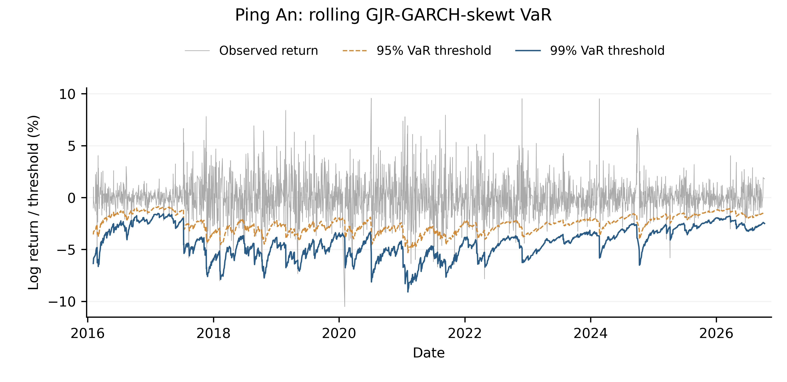

#### 2. 宁波银行

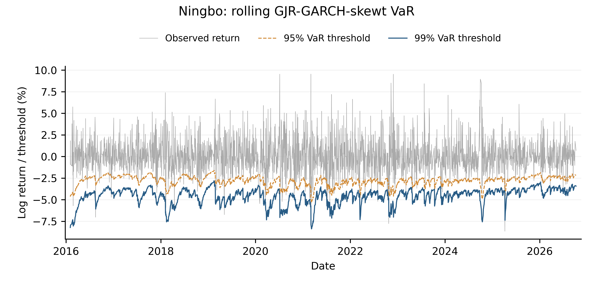

#### 3. 浦发银行

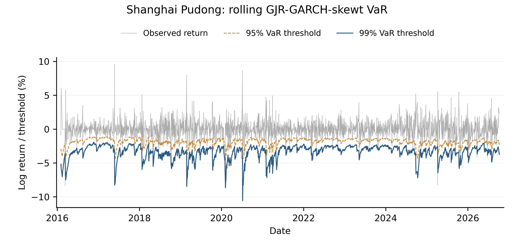

#### 4. 华夏银行

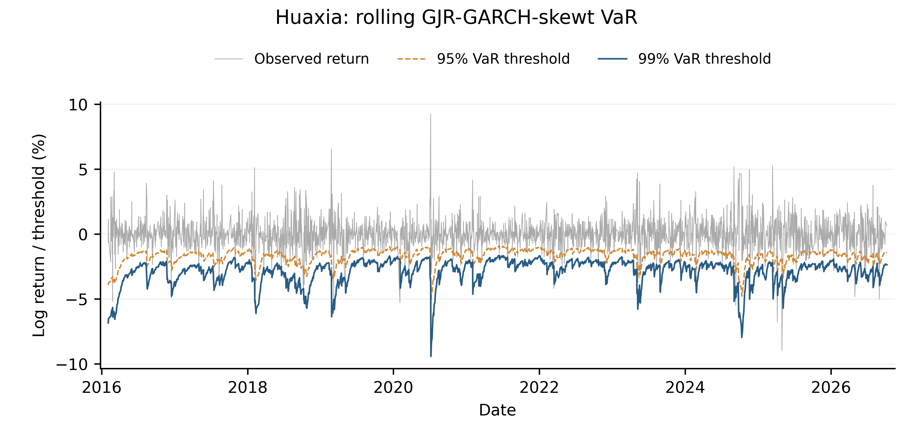

#### 5. 民生银行

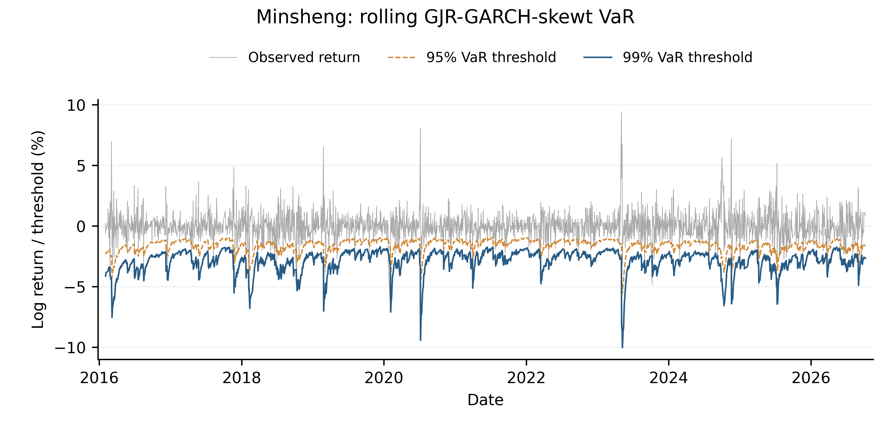

#### 6. 招商银行

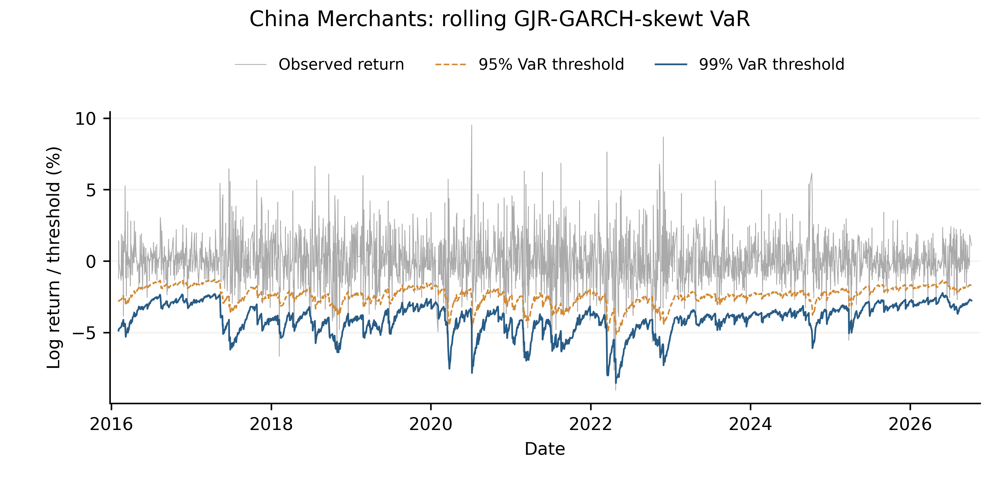

#### 7. 南京银行

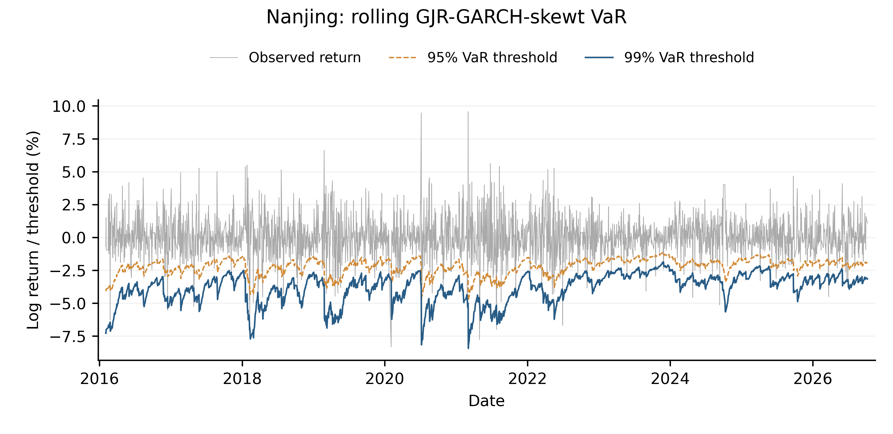

#### 8. 兴业银行

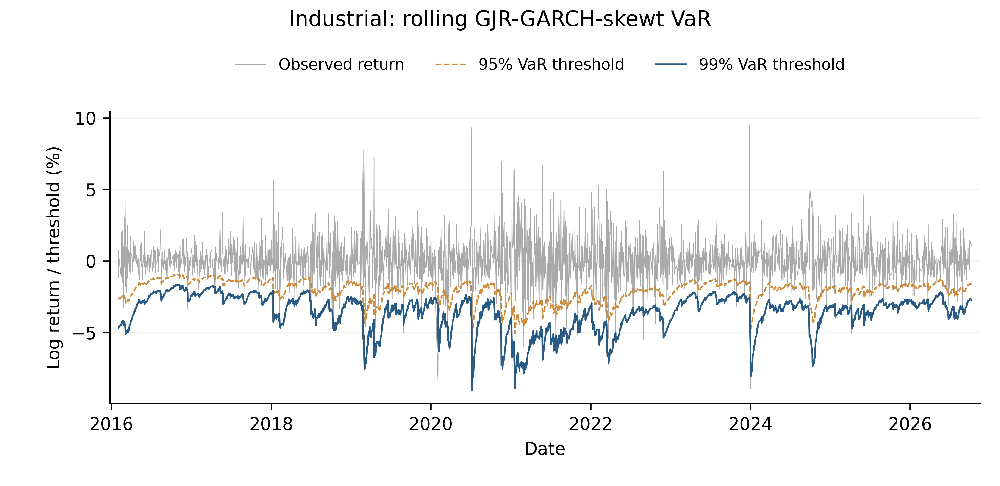

#### 9. 北京银行

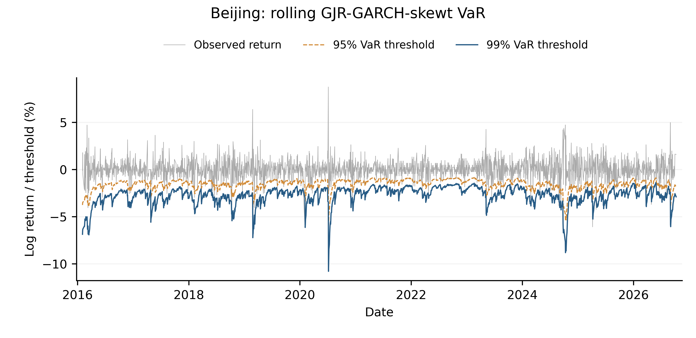

#### 10. 交通银行

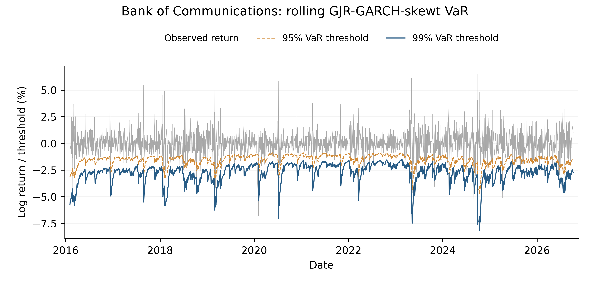

#### 11. 工商银行

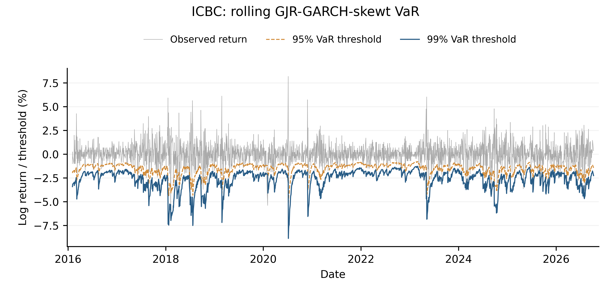

#### 12. 建设银行

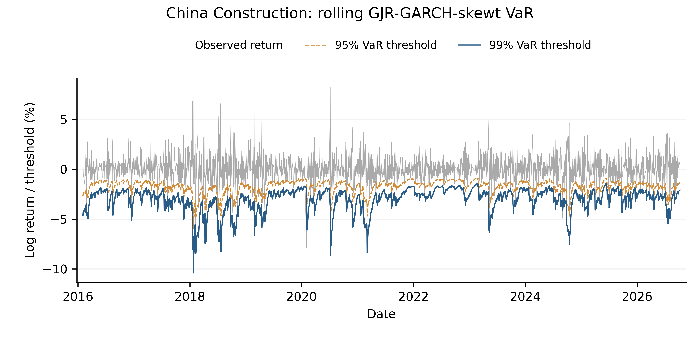

#### 13. 中国银行

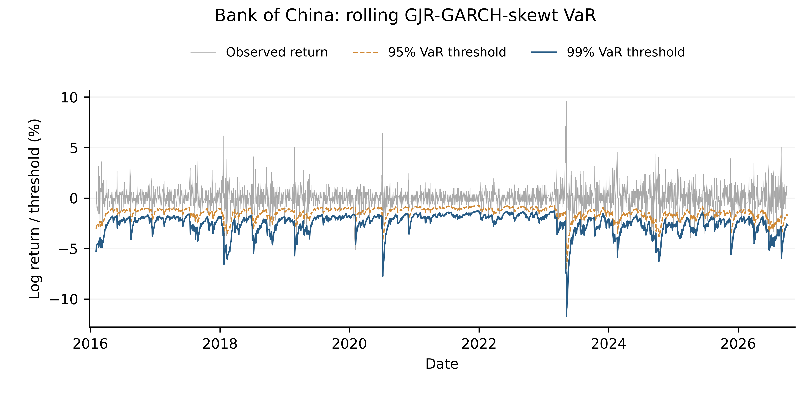

#### 14. 中信银行

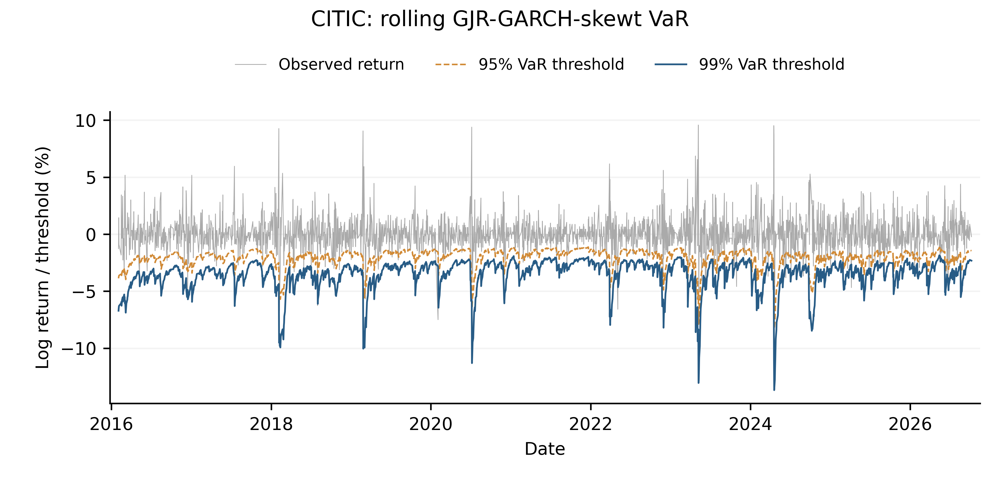

### 逐银行分位数损失与违背率

括号内为违背次数，每家分母均为2575。

| 银行 | 99% pinball | 95% pinball | 99%违背率（次数） | 95%违背率（次数） |
|---|---:|---:|---:|---:|
| 平安银行 | 0.053643 | 0.177571 | 0.854% (22) | 4.854% (125) |
| 宁波银行 | 0.055948 | 0.189293 | 0.660% (17) | 4.932% (127) |
| 浦发银行 | 0.044664 | 0.135148 | 1.010% (26) | 4.583% (118) |
| 华夏银行 | 0.040448 | 0.122810 | 1.049% (27) | 4.932% (127) |
| 民生银行 | 0.035904 | 0.113761 | 0.816% (21) | 4.893% (126) |
| 招商银行 | 0.051118 | 0.174270 | 1.165% (30) | 4.738% (122) |
| 南京银行 | 0.049550 | 0.158549 | 0.854% (22) | 4.583% (118) |
| 兴业银行 | 0.046225 | 0.151695 | 1.010% (26) | 5.165% (133) |
| 北京银行 | 0.035943 | 0.112829 | 0.893% (23) | 4.621% (119) |
| 交通银行 | 0.035319 | 0.112625 | 0.699% (18) | 4.854% (125) |
| 工商银行 | 0.031335 | 0.110775 | 0.816% (21) | 5.515% (142) |
| 建设银行 | 0.035937 | 0.125107 | 0.738% (19) | 5.359% (138) |
| 中国银行 | 0.030385 | 0.105545 | 0.777% (20) | 4.777% (123) |
| 中信银行 | 0.044258 | 0.143454 | 0.777% (20) | 5.126% (132) |

## 6. 计算与复现

默认完整回放含4575条收益，评价2575条，产生515个重估时点、每个时点14家银行拟合。本次完整复算耗时约92.96秒（含初始化），仅代表当时机器与运行条件，不是跨平台速度承诺。

出现1次拟合重试后仍失败：索引2150、平安银行，求解器状态8。该银行按既定策略保留旧参数与当前预测方差，其预测仍计入评分。完整记录见 [运行汇总](results/summary.json)。

重组前独立计算与原实验全部预测逐项一致，最大绝对误差为0。此版本调整文件布局和文档，保持模型数值逻辑。参考数组 `results/predictions.npy` 维度为2575×14×2，银行顺序同数据，最后一维对应1%和5%收益下尾。

运行与绘图命令见 [README](../README.md)。模型代码位于 `code/gjr_var/model.py`，主程序位于 `code/run.py`，绘图源代码位于 `code/plot_results.py`。不需要其他研究项目或私人路径。

## 7. 结论与边界

1. 默认滚动 GJR-GARCH-skewt 在当前银行数据上得到上述可复现的 VaR 损失和违背率。95%档总体频率接近目标，99%档总体频率稍低。
2. 这是一个具有明确条件波动与厚尾偏态结构的边际风险基线。仅凭本报告单模型结果，不能推出优于所有其他方法。
3. 本报告没有证明流式参数更新与滚动重估统计等价，也没有证明逐条 Adam 更新收敛。
4. 银行 VaR 不是系统联合风险；本代码未计算 CoVaR、ΔCoVaR、ES或因果传染效应。
5. 历史评价区间已在研究中被多次查看，属于探索性历史回测，不是新的独立盲测。极端尾部样本有限，泛化结论还需要新的评价期或预先设计的模拟实验。

## 8. 数据及实现来源

行情来自既有 BaoStock 数据归档（https://www.baostock.com/）。模型由项目既有滚动窗口对照实现独立提取，分布与估计依赖 arch 7.2.0；数据处理细节见 data/README.md。第三方市场数据再分发许可未在本次整理中独立核实，不能视为本项目原创数据授权。代码尚未指定开源许可证。
